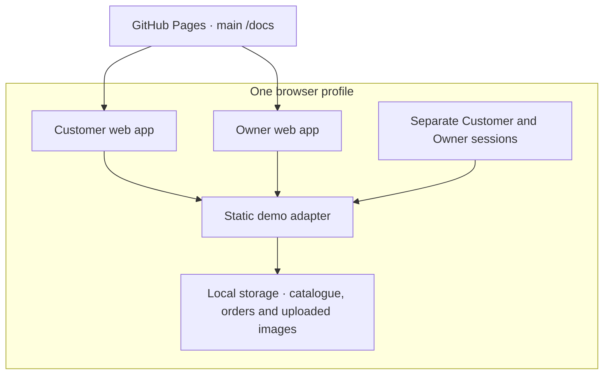
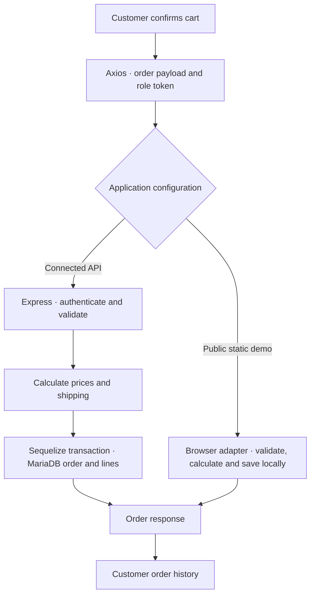
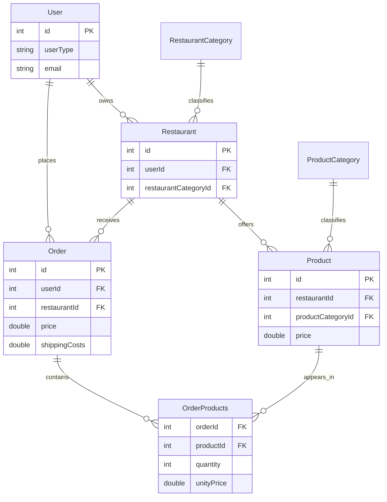

# DeliverUS

DeliverUS is a collaborative restaurant ordering project with separate applications for customers and restaurant owners. Customers browse restaurants, filter the catalogue, choose products and manage pending orders. Owners manage their restaurants and products, including images, and move orders through preparation, dispatch and delivery.

**[Open Customer](https://nicodalba.github.io/deliverus/customer/)** · **[Open Owner](https://nicodalba.github.io/deliverus/owner/)**

The public version is a free, static demonstration of the original applications. Orders and edits are saved in your browser, so use the same browser profile for both roles and enter fictional information. GitHub Pages serves the applications directly, with no backend startup delay.

## How it’s built

The repository contains two Expo SDK 52 / React Native applications using React Navigation and Axios, plus an Express REST API. In the connected configuration, Axios reads `API_BASE_URL` through Babel, sends requests to Express and attaches a Bearer token after login. Passport checks the token, its expiry and the user’s role. Sequelize maps the application models to MariaDB tables and manages migrations and transactions.

The current public deployment uses GitHub Pages, publishing `main` from `/docs`. Its web exports live under `/customer/` and `/owner/`. With `EXPO_PUBLIC_STATIC_DEMO=true`, the shared Axios adapter in `demo/staticApi.js` handles operations inside the browser using the initial catalogue in `demo/catalog.json`. The deployed apps use fixed demonstration identities and browser storage. The local setup below runs Express and MariaDB. The public demo runs entirely through its browser adapter.



Images shipped with the demo are static assets. Images added through Owner are stored as data URLs in that browser’s demo state. In the connected application, Multer saves uploaded files beneath `UPLOAD_ROOT`, using the configured avatar, restaurant and product folders. Express serves them under `/public`, with bundled example images as a fallback. Their durability depends on retaining that filesystem alongside MariaDB. The public demo’s image persistence comes from browser storage.

| Directory | Responsibility |
| --- | --- |
| `DeliverUS-Frontend-Customer/` | Customer catalogue, menus, profile and order screens |
| `DeliverUS-Frontend-Owner/` | Owner restaurant, product and restaurant-order screens |
| `DeliverUS-Backend/` | Express routes, validation, authentication, Sequelize models, migrations and E2E tests |
| `demo/` | Shared browser adapter and initial demonstration data |
| `docs/` | Published entry page, web exports and static assets |

## What happens when you place an order

In the connected application, confirming the cart calls `POST /orders` with a restaurant ID, a delivery address and product IDs with quantities. Axios supplies the logged-in customer’s Bearer token. The route checks authentication, the customer role and the restaurant, then validates the address, quantities, product availability and membership of each product in that restaurant.

`OrderController.create` reads prices from the database and calculates the subtotal. Shipping is free from €10. Below that threshold it uses the restaurant’s shipping charge. A Sequelize transaction saves the order and its product lines, including quantity and the current unit price. After committing, the controller returns the saved order with its products as JSON. A failure rolls the transaction back. Editing a pending order recalculates prices using the same shipping rule.

The public demo follows the interface’s same API calls through its browser adapter. It checks the demonstration role and order data, calculates the total and saves the resulting state locally before returning a response to the screen.



Owner retrieves a restaurant’s orders and advances them through `pending → in process → sent → delivered`. The connected API uses `PATCH /orders/:orderId/confirm`, `/send` and `/deliver`, checking restaurant ownership and the preceding state. It records `startedAt`, `sentAt` and `deliveredAt`; the model derives the status from those timestamps. Customers can edit or cancel their own orders while pending. Cancellation removes the order.

Screens fetch data again on their navigation or refresh paths. Owner reloads the list after an action and offers an explicit refresh control. To see an update in Customer, reopen the order or reload the app and open its history. Updates appear through these reads; the applications have no live push channel.

## Data model

A `User` has a customer or owner role. Owners have restaurants, and customers place orders. Each restaurant belongs to a restaurant category and contains products, each assigned to a product category. Every order belongs to one customer and one restaurant.

Orders and products have a many-to-many relationship through `OrderProducts`. Each line records `quantity` and the unit price captured for that order, named `unityPrice` in the schema. This preserves the order’s recorded price when the catalogue changes. The static demo represents these lines in its browser state and returns the product relationship in the shape expected by the original screens.



## Running the demo

Open Customer and Owner in the same browser profile. The fixed accounts below work in the public demo and in the local seeded database.

| Role | Email | Password |
| --- | --- | --- |
| Customer | `customer1@customer.com` | `secret` |
| Owner | `owner1@owner.com` | `secret` |

In Customer, choose a restaurant with available products, sign in, add a product and confirm an order with a fictional address. Open its history to inspect or edit it, and create another pending order to try cancellation. In Owner, sign in, open an owned restaurant, edit a product or upload an image, then use its orders view to prepare, dispatch and complete the customer’s order.

Browser storage retains orders, edits and images across reloads and browser restarts, and across site updates that keep the same storage schema. Other devices, browser profiles and private sessions have separate copies. Clearing site data or using the banner’s reset control removes that copy and both saved sessions. Image uploads accept PNG/JPEG files smaller than 2 MB and are subject to browser storage limits.

Public demo accounts have read-only profiles and fixed credentials, and registration is disabled in this mode. The additional control-panel screen remains a placeholder. These are demonstration orders, with no payment processing or real delivery service. The public flows were checked for ordering, editing, cancellation, owner product/image changes, status transitions, mobile and desktop layouts, and persistence after a site update.

## Run locally

Use Node.js 24 LTS, npm, MariaDB and a POSIX shell for the commands below. The connected setup was previously tested with MariaDB 11.4. Keep its database disposable and separate from any valuable data.

Start with a fresh clone. Run this block from the directory where you want the repository.

```sh
git clone https://github.com/NicodAlba/deliverus.git
cd deliverus
node --version
npm --version
```

Start your local MariaDB server using your normal installation method. In a MariaDB client connected as the local administrator, create a dedicated database and a user whose grants are limited to it.

```sql
CREATE DATABASE deliverus_sandbox CHARACTER SET utf8mb4;
CREATE USER 'deliverus_local'@'127.0.0.1'
  IDENTIFIED BY 'deliverus_local_demo';
GRANT ALL PRIVILEGES ON deliverus_sandbox.*
  TO 'deliverus_local'@'127.0.0.1';
```

From the fresh repository root, prepare the backend. Its example environment points to that database on `127.0.0.1:3306`, with the API on port 3000. Adjust the database port if your local server uses another one. The CORS origins below allow the two local web applications.

```sh
cd DeliverUS-Backend
cp .env.example .env
printf '\nALLOWED_ORIGINS=http://localhost:8081,http://localhost:8082\n' >> .env
npm ci
npm run db:migrate
npm run db:seed
```

`db:migrate` applies pending migrations without resetting the schema. Run `db:seed` once on this new database to install the example accounts, restaurants and products. The ordinary development seeding command can duplicate data when repeated. Keep an existing working `.env` when updating an existing checkout and verify its database before running database commands.

In the same backend directory, start the API. Subsequent normal starts use this command with the existing database.

```sh
# Working directory: deliverus/DeliverUS-Backend
npm start
```

From another terminal, check the database-backed health endpoint and catalogue.

```sh
# Any working directory, while the API and MariaDB are running
curl -fsS http://localhost:3000/health
curl -fsS http://localhost:3000/restaurants
```

Start Customer in a new terminal, beginning at the repository root.

```sh
cd DeliverUS-Frontend-Customer
cp .env.example .env
npm ci
EXPO_PUBLIC_STATIC_DEMO=false npx expo start --web --localhost --port 8081
```

Start Owner in another terminal, also beginning at the repository root.

```sh
cd DeliverUS-Frontend-Owner
cp .env.example .env
npm ci
EXPO_PUBLIC_STATIC_DEMO=false npx expo start --web --localhost --port 8082
```

Open Customer at `http://localhost:8081` and Owner at `http://localhost:8082`. Both examples set `API_BASE_URL=http://localhost:3000`. Babel incorporates that URL into the frontend build, so restart Metro with `--clear` after changing it. Keep `WEB_BASE_PATH` unset for these local development servers. MariaDB stores connected-mode changes across application restarts, and uploaded files remain beneath the configured upload root.

For E2E tests, stop the API, leave MariaDB running and verify that the backend `.env` still names `deliverus_sandbox`. From the backend directory, run the suite against that disposable database. Tests create and modify records. The recorded implementation verification passed 213 E2E tests against disposable MariaDB.

```sh
# Working directory: deliverus/DeliverUS-Backend
npm test -- --runInBand
```

**The development reset is destructive.** `npm run migrate` undoes all migrations, recreates the schema and seeds example data. It deletes existing application data in the configured database. Use it only to restore a disposable local database, with the API stopped. The script blocks execution when `NODE_ENV=production`.

```sh
# Working directory: deliverus/DeliverUS-Backend
# First verify DATABASE_NAME=deliverus_sandbox in .env.
npm run migrate
```

To rebuild the free public demo from the repository root, use the existing build script. It installs both frontend lockfiles, exports their web bundles and replaces the generated app files in `docs/`. It requires Node 24 and npm, and works independently of MariaDB.

```sh
# Working directory: deliverus
npm run build:demo
```

## Credits and license

DeliverUS is the work of its original collaborators. Contribution names and aliases include lacatu5, AlexMG-05, NicodAlba, aurbinat, BlitzAlexx and SrAlex73.

The backend retains its [CC0 1.0 notice](./DeliverUS-Backend/LICENSE). Other components and assets retain their applicable rights and notices. The published bundles include [third-party notices](./docs/third-party-notices.txt).
