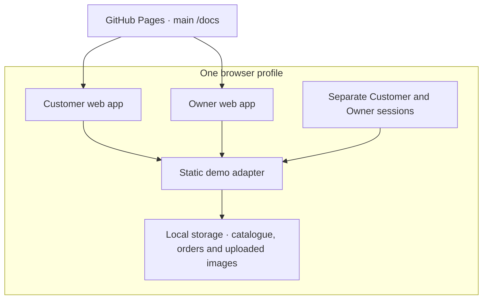
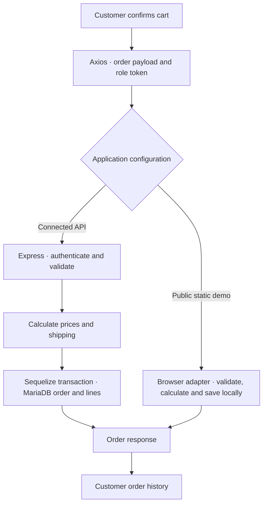
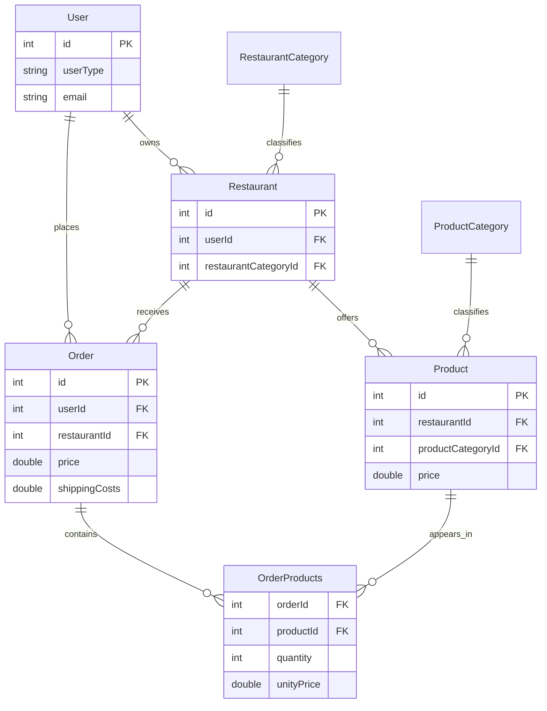

# DeliverUS

DeliverUS is a collaborative restaurant ordering project. Customers browse restaurants, choose products and manage pending orders. Owners manage their catalogue and images, then prepare, dispatch and complete orders.

**[Open Customer](https://nicodalba.github.io/deliverus/customer/)** · **[Open Owner](https://nicodalba.github.io/deliverus/owner/)**

The public version is a free static demo. Use the same browser profile for both roles and enter fictional information. Orders and edits are saved in that browser.

## How it’s built

The two Expo SDK 52 / React Native applications use React Navigation and Axios. In connected mode, Axios calls the Express API with a Bearer token. Passport checks authentication and roles, while Sequelize persists models and transactions in MariaDB.

GitHub Pages publishes `main` from `/docs`. With `EXPO_PUBLIC_STATIC_DEMO=true`, `demo/staticApi.js` handles the apps’ calls in the browser using `demo/catalog.json` and local storage. The local setup below runs Express and MariaDB.



Bundled images are static assets. Owner uploads are stored as data URLs in browser storage. In connected mode, Multer writes files beneath `UPLOAD_ROOT` and Express serves them under `/public`. Retain that filesystem alongside MariaDB to preserve uploads.

| Directory | Responsibility |
| --- | --- |
| `DeliverUS-Frontend-Customer/` | Customer catalogue, menus, profile and order screens |
| `DeliverUS-Frontend-Owner/` | Owner restaurant, product and restaurant-order screens |
| `DeliverUS-Backend/` | Express routes, validation, authentication, Sequelize models, migrations and E2E tests |
| `demo/` | Shared browser adapter and initial demonstration data |
| `docs/` | Published entry page, web exports and static assets |

## What happens when you place an order

In connected mode, the cart sends `POST /orders` with the restaurant, address and product quantities. The API checks the customer’s Bearer token, role, restaurant, product availability and quantities.

`OrderController.create` calculates prices from MariaDB. Shipping is free from €10 and otherwise uses the restaurant’s charge. A Sequelize transaction saves the order and its lines with quantity and unit price, then returns JSON. Failures roll back the transaction. Pending-order edits use the same shipping rule.

The public demo’s browser adapter checks the role and order data, calculates the total and saves it locally before responding to the screen.



Owner advances orders through `pending → in process → sent → delivered`. The API’s `/confirm`, `/send` and `/deliver` PATCH routes check ownership and the preceding state, then record the corresponding timestamp. Customers can edit or cancel their own pending orders. Cancellation removes the order.

Screens refetch through navigation and refresh actions. Owner refreshes after status changes. In Customer, reopen the order or reload the app and open its history to see updates. There is no live push channel.

## Data model

Owners have restaurants, and customers place orders. Each restaurant has a category and products. Each product has a product category. Every order belongs to one customer and one restaurant.

`OrderProducts` joins orders and products, storing `quantity` and the captured unit price, named `unityPrice` in the schema. The static demo returns these relationships in the shape expected by the original screens.



## Running the demo

Open Customer and Owner in the same browser profile. The fixed accounts below work in the public demo and in the local seeded database.

| Role | Email | Password |
| --- | --- | --- |
| Customer | `customer1@customer.com` | `secret` |
| Owner | `owner1@owner.com` | `secret` |

In Customer, sign in, choose products and place an order with a fictional address. Open its history to edit or cancel it while pending. In Owner, edit a restaurant or product, upload an image and use its orders view to complete the order cycle.

Orders, edits and images survive reloads, browser restarts and site updates that keep the same storage schema. Other browser profiles and devices have separate copies. Clearing site data or using the reset control removes local demo data and sessions. PNG/JPEG uploads must be smaller than 2 MB and fit within browser storage limits.

Demo profiles and credentials are fixed, and registration is disabled. The additional control panel remains a placeholder. Orders are demonstrations without payments or real delivery. Ordering, owner edits, status changes, mobile/desktop layouts and persistence after a site update have been checked.

## Run locally

Use Node.js 24 LTS, npm, MariaDB and a POSIX shell. MariaDB 11.4 was used for verification. Keep the local database disposable.

Clone from the directory where you want the repository.

```sh
git clone https://github.com/NicodAlba/deliverus.git
cd deliverus
node --version
npm --version
```

Start MariaDB, then run this SQL as its local administrator.

```sql
CREATE DATABASE deliverus_sandbox CHARACTER SET utf8mb4;
CREATE USER 'deliverus_local'@'127.0.0.1'
  IDENTIFIED BY 'deliverus_local_demo';
GRANT ALL PRIVILEGES ON deliverus_sandbox.*
  TO 'deliverus_local'@'127.0.0.1';
```

From the fresh repository root, prepare the backend. The example uses MariaDB on `127.0.0.1:3306` and API port 3000. Adjust the database port if needed. The CORS origins allow both local frontends.

```sh
cd DeliverUS-Backend
cp .env.example .env
printf '\nALLOWED_ORIGINS=http://localhost:8081,http://localhost:8082\n' >> .env
npm ci
npm run db:migrate
npm run db:seed
```

`db:migrate` applies pending migrations. Run `db:seed` once on the new database to install example data. Repeating development seeding can duplicate records. On an existing checkout, preserve the working `.env` and verify its database first.

Start the API from the backend directory. Use this command for subsequent normal starts.

```sh
# Working directory: deliverus/DeliverUS-Backend
npm start
```

In another terminal, check database connectivity and the catalogue.

```sh
# Any working directory, while the API and MariaDB are running
curl -fsS http://localhost:3000/health
curl -fsS http://localhost:3000/restaurants
```

Start Customer in a new terminal, beginning at the repository root.

```sh
cd DeliverUS-Frontend-Customer
cp .env.example .env
npm ci
EXPO_PUBLIC_STATIC_DEMO=false npx expo start --web --localhost --port 8081
```

Start Owner in another terminal, also beginning at the repository root.

```sh
cd DeliverUS-Frontend-Owner
cp .env.example .env
npm ci
EXPO_PUBLIC_STATIC_DEMO=false npx expo start --web --localhost --port 8082
```

Open Customer at `http://localhost:8081` and Owner at `http://localhost:8082`. Both examples use `API_BASE_URL=http://localhost:3000`. Restart Metro with `--clear` after changing that URL, and keep `WEB_BASE_PATH` unset. Connected-mode data persists in MariaDB and files in the configured upload root.

For E2E tests, stop the API, keep MariaDB running and verify `DATABASE_NAME=deliverus_sandbox` in the backend `.env`. Tests modify records. The recorded implementation check passed 213 E2E tests.

```sh
# Working directory: deliverus/DeliverUS-Backend
npm test -- --runInBand
```

**The development reset is destructive.** `npm run migrate` undoes all migrations, recreates the schema and seeds data. Use it only against the disposable local database with the API stopped. It is blocked when `NODE_ENV=production`.

```sh
# Working directory: deliverus/DeliverUS-Backend
# First verify DATABASE_NAME=deliverus_sandbox in .env.
npm run migrate
```

To rebuild the demo, run the existing script from the repository root. It installs the frontend lockfiles and replaces the generated apps in `docs/`, independently of MariaDB.

```sh
# Working directory: deliverus
npm run build:demo
```

## Credits and license

DeliverUS is the work of its original collaborators. Contribution names and aliases include lacatu5, AlexMG-05, NicodAlba, aurbinat, BlitzAlexx and SrAlex73.

The backend retains its [CC0 1.0 notice](./DeliverUS-Backend/LICENSE). Other components and assets retain their applicable rights and notices. The published bundles include [third-party notices](./docs/third-party-notices.txt).
